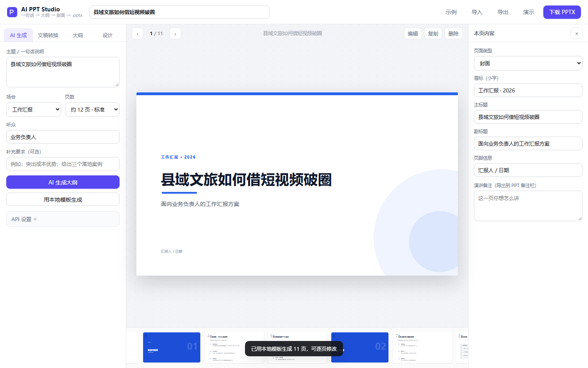

# AI PPT Studio

> 输入一个主题，生成一份能讲、能改、能导出的 PPT。

一个**纯前端**的 AI 演示文稿工具：浏览器里写主题 → 生成大纲 → 实时预览版面 → 一键导出可编辑的 `.pptx`。
不需要后端、不需要数据库、不需要构建步骤，把文件夹丢到任何静态托管（GitHub Pages / Gitee Pages / Vercel / 对象存储）就能给别人用。


**快速跳转**：[在线体验](#快速开始) · [部署教程](docs/部署教程.md) · [接入大模型](#接入大模型) · [二次开发](#二次开发)



---

## 它解决什么问题

用 AI 生成 PPT 的工具不少，但多数要么只能出一张张图片（改不了），要么必须登录某个 SaaS（数据出门），要么导出的 `.pptx` 一看就是模板堆出来的。

这个项目走的是另一条路：

- **版面是算出来的**，不是套图片。每页由「绘制指令」渲染，屏幕预览和 `.pptx` 用的是同一套坐标与字号，所以导出结果和你在网页上看到的一致。
- **拿到的是真 PPT**。文字、色块都是 PowerPoint 原生对象，能改字、改色、改字号、加动画，备注栏里还带着演讲提示。
- **可以完全离线**。不填 API Key 也能用本地规则引擎出一份结构完整的骨架；填了就用大模型写内容。

---

## 功能

**生成**

- AI 生成：兼容 OpenAI 接口格式（DeepSeek / 通义千问 / Kimi / 智谱 / Ollama / 自建代理都可）
- 本地模板：不联网也能生成"封面 → 目录 → 章节 → 内容 → 结论 → 结尾"的完整结构
- 文稿转换：把 Markdown 或一段长文直接拆成页面（`#` 成章、`##` 成页、`-` 成要点、`>` 成金句）

**编辑**

- 大纲面板：拖拽排序、复制、删除、按类型新建页面
- 逐页编辑：右侧检查器改标题 / 导语 / 要点 / 指标，改完立刻反映到画布
- 六套配色主题、四种中文字体，一键切换整套风格
- 自动保存到浏览器本地，刷新不丢；也能导出 / 导入 `.json` 项目文件

**呈现**

- 全屏演示模式，方向键翻页，Esc 退出
- 底部缩略图条，随时跳页

**导出**

- `.pptx`：16:9，文字可编辑，演讲备注写入备注栏
- `.json`：整份项目，方便备份与迁移

---

## 快速开始

### 方式一：直接打开（最快）

双击 `index.html`，浏览器打开即可用。所有依赖都已内置在 `assets/vendor/` 里，断网也能跑。

### 方式二：本地起个服务（推荐，避免个别浏览器的本地文件限制）

```bash
# 任选其一
python -m http.server 8080
npx serve .
```

然后访问 <http://localhost:8080>。

### 方式三：发布到网上，让所有人都能用

本项目是**纯静态站点**，没有构建步骤。上传文件夹 → 开启静态托管，两步就完事。

**GitHub Pages（推荐，自带自动部署）**

仓库里已经放好了 `.github/workflows/deploy.yml`，推上去基本不用再配置：

1. GitHub 新建仓库（Public，不要勾选 README），把代码推上去；
2. **Settings → Pages → Source** 选 **GitHub Actions**；
3. 等 Actions 跑完，访问 `https://xd335.github.io/ai-ppt-studio/`。

```bash
git remote add origin https://github.com/xd335/ai-ppt-studio.git
git push -u origin main
```

**Gitee Pages（国内更快）**

新建仓库并导入 GitHub 项目 → **服务 → Gitee Pages** → 分支 `master`、目录留空 → 启动。需要实名认证。

> 一步步的图文操作、常见报错排查、自定义域名，见 **[docs/部署教程.md](docs/部署教程.md)**。
> Vercel / Netlify / Cloudflare Pages 也都能用：Build command 留空，Output directory 填 `.`。

---

## 接入大模型

点左侧「API 设置」，填三项即可，Key 只保存在**本机浏览器**（`localStorage`），不会上传到任何服务器。

| 服务 | 接口地址 | 模型 |
| --- | --- | --- |
| DeepSeek | `https://api.deepseek.com/v1` | `deepseek-chat` |
| 阿里云百炼（通义） | `https://dashscope.aliyuncs.com/compatible-mode/v1` | `qwen-plus` |
| 智谱 | `https://open.bigmodel.cn/api/paas/v4` | `glm-4-plus` |
| Moonshot | `https://api.moonshot.cn/v1` | `moonshot-v1-8k` |
| OpenAI | `https://api.openai.com/v1` | `gpt-4o-mini` |
| 本地 Ollama | `http://localhost:11434/v1` | `qwen2.5:7b` |

**关于跨域（CORS）**：浏览器直连第三方接口时，对方必须允许跨域。DeepSeek 等主流服务目前允许；如果遇到「无法连接接口」，有两个办法：

1. 用「本地模板」生成，再手动改内容（完全够用）；
2. 自己起一个转发代理，把接口地址填成代理地址。一个最小的 Cloudflare Worker 示例：

```js
export default {
  async fetch(request) {
    const url = new URL(request.url);
    const target = 'https://api.deepseek.com' + url.pathname;
    return fetch(target, {
      method: request.method,
      headers: request.headers,
      body: request.body
    });
  }
};
```

然后接口地址填 `https://你的worker地址/v1`。

---

## 使用流程

1. **写主题**：一句话就够，比如「县域文旅如何借短视频破圈」。主题越具体，产出越具体。
2. **选场合和页数**：场合影响开场与结尾的口吻，页数决定章节数量与每章展开程度。
3. **生成**：有 Key 点「AI 生成大纲」，没有就点「用本地模板生成」。
4. **改**：左侧「大纲」调顺序，右侧检查器改文字。改完 0.2 秒内画布就会刷新。
5. **换风格**：「设计」里点主题卡片，六套配色随你挑。
6. **导出**：右上角「下载 PPTX」。

---

## 十种版式

| 类型 | 用途 | 字段 |
| --- | --- | --- |
| `cover` 封面 | 开篇 | 眉标 / 主标题 / 副标题 / 页脚 |
| `toc` 目录 | 章节索引 | 条目列表（1—8 条） |
| `section` 章节页 | 章节过渡 | 编号 / 标题 |
| `bullets` 要点页 | 最常用，3—6 条 | 标题 / 导语 / 要点（小标题 + 说明） |
| `twoCol` 双栏页 | 两栏并列 | 两栏标题 + 条目 |
| `stats` 数据页 | 2—4 个关键数字 | 数值 / 名称 / 说明 |
| `timeline` 流程页 | 3—5 步路径 | 阶段 / 说明 |
| `compare` 对比页 | 现状 vs 目标 | 左右两组标题 + 条目 |
| `quote` 金句页 | 转折、收束 | 金句 / 署名 |
| `end` 结束页 | 收尾 | 主标题 / 副标题 / 页脚 |

版式会自动做这几件事：标题过长时缩字号、要点太多时均分并收缩行距、双栏与对比页面板高度按内容自适应。

---

## 目录结构

```
ai-ppt-studio/
├── index.html                  单页入口
├── assets/
│   ├── css/app.css             界面样式
│   ├── js/
│   │   ├── core.js             主题、字体、文本度量（自动缩字号的核心）
│   │   ├── layouts.js          10 种版式 → 绘制指令（单位：英寸）
│   │   ├── render-html.js      绘制指令 → DOM（预览）
│   │   ├── render-pptx.js      绘制指令 → PptxGenJS（导出）
│   │   ├── generator.js        AI 提示词、本地规则引擎、Markdown 转换
│   │   └── app.js              界面与交互
│   └── vendor/pptxgenjs/       内置的 pptxgenjs 3.12（MIT）
├── docs/
│   ├── 部署教程.md             从零发布到 GitHub / Gitee 的逐步操作
│   └── screenshot.png
├── examples/                   导出的样张
├── tools/                      开发自测脚本（生成样张、界面冒烟测试）
├── .github/workflows/deploy.yml  GitHub Pages 自动部署
└── .nojekyll                   让 GitHub Pages 跳过 Jekyll
```

核心思想只有一条：**版面只描述一次**。`layouts.js` 输出的是 `{类型, x, y, w, h, 文字, 颜色, 字号}` 这样的数组，两个渲染器各自翻译成 DOM 或 PPT 对象。想改版面只改一处，预览和导出永远同步。

---

## 二次开发

**加一套配色**：在 `core.js` 的 `THEMES` 里追加一项，填好 `bg / ink / body / accent / accentSoft / line / sectionBg` 即可，界面会自动多一张卡片。

**加一种版式**：

1. 在 `layouts.js` 写一个函数，返回绘制指令数组（参考 `bullets`）；
2. 在 `MAP` 里注册；
3. 在 `SLIDE_TYPES` 里加一行（界面、新建菜单、类型下拉都会自动出现）；
4. 在 `app.js` 的 `FIELDS` 里描述它在检查器里有哪些字段。

**改导出细节**：`render-pptx.js` 里 `textOpts()` 控制字体、行距、内边距；`shapeOpts()` 控制填充与描边。

---

## 自测

```bash
node tools/build-demo.js minimal        # 用本地引擎生成一份 pptx 样张
node tools/ui-test.js                   # 无头 Chrome 跑一遍界面冒烟测试并截图
```

`tools/ui-test.js` 需要本机有 Chrome；它会把截图和检查结果写到 `.tmp/`。

---

## 常见问题

**导出的 PPT 里字体不对？**
默认用「微软雅黑」，Windows 上一定有；macOS 上会自动替换成苹方。要更保险，可以在「设计 → 字体」里换成宋体或等线。

**某一页文字太多、挤在一起？**
工具会自动缩字号，但缩到 9pt 就不再缩了——那是提醒你该拆页了。复制一页，把内容分到两页，效果最好。

**刷新后内容没了？**
内容保存在浏览器 `localStorage`。无痕窗口、清理站点数据、换浏览器都会丢。重要的稿子请用「导出」存成 `.json`。

**能商用吗？**
MIT 许可，随便用。内置的 pptxgenjs 同样是 MIT。

---

## 许可

MIT
